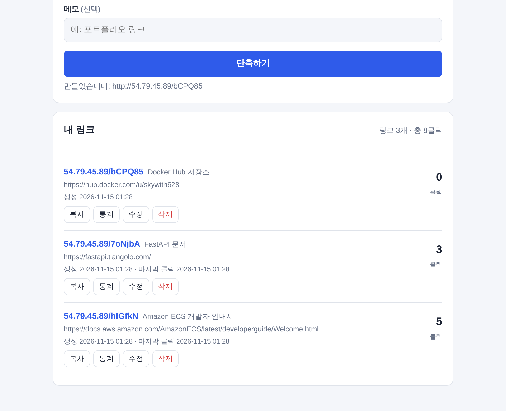
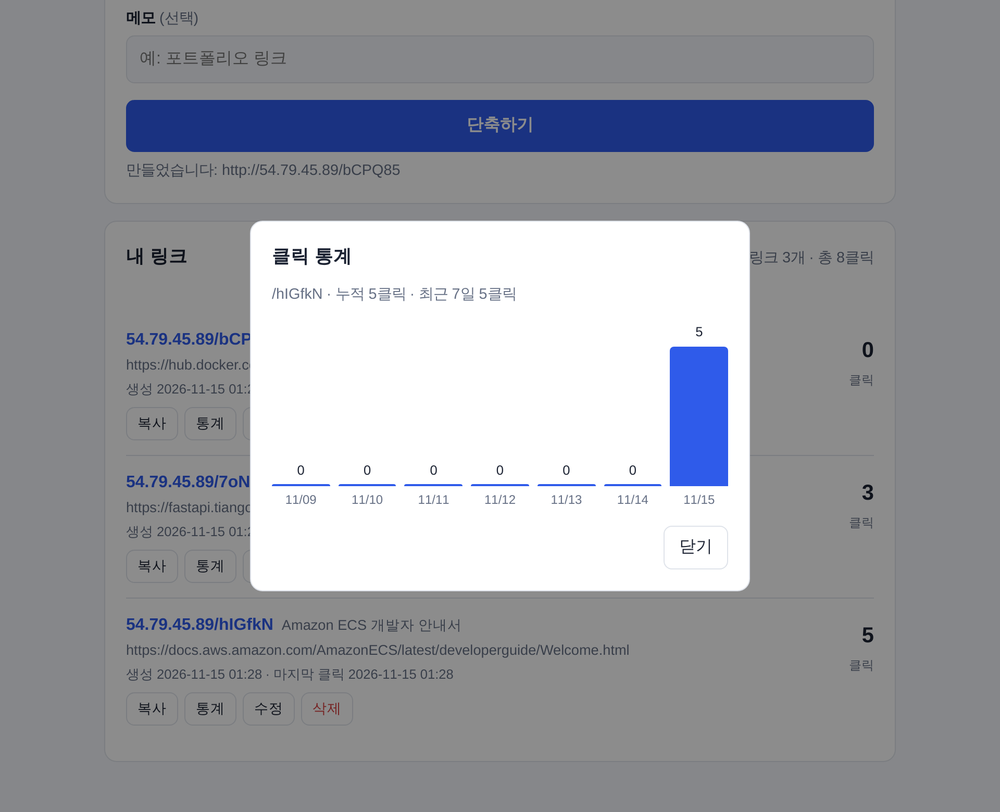
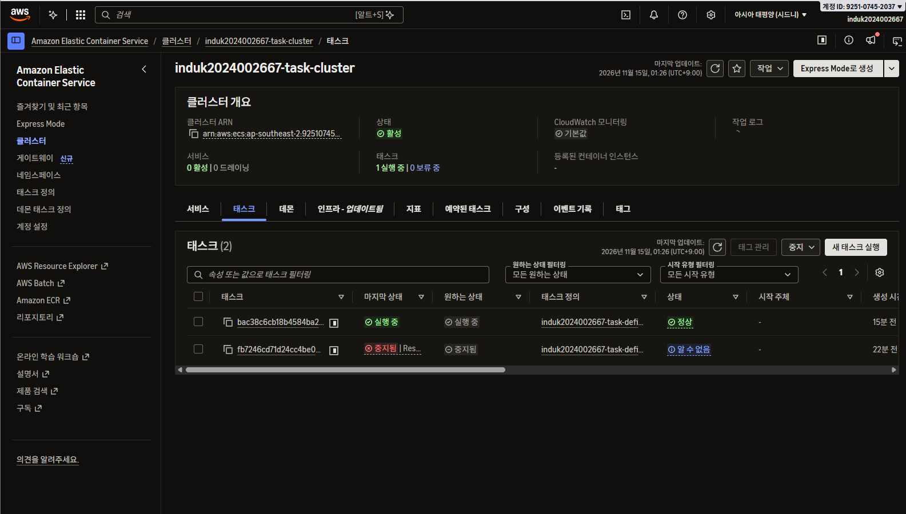
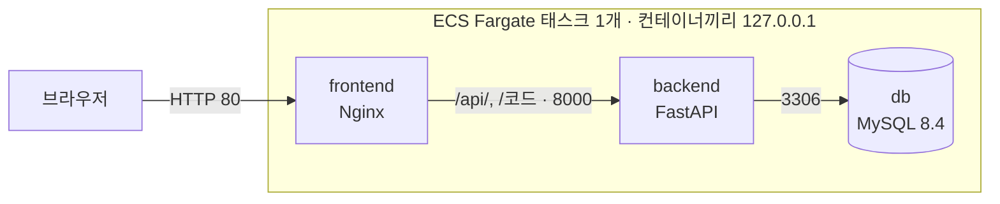

# Snip — URL 단축 서비스
> 긴 URL을 6자 코드로 줄이고 클릭 수를 집계하는 웹 서비스. 컨테이너 3개로 나눠 Amazon ECS(Fargate)에 배포했다.



| 클릭 통계 | ECS에서 실행 중인 태스크 |
|---|---|
|  |  |

## 📌 문제 정의 / 만든 이유
URL 단축 서비스는 화면은 단순하지만 백엔드에서 정해야 할 것이 분명하다. 이 프로젝트는 세 가지 질문에 직접 답하는 것을 목표로 했다.

- **코드가 겹치지 않게 하려면?** 동시에 요청이 들어와도 같은 코드가 두 번 저장되면 안 된다.
- **클릭을 빠짐없이 세려면?** 브라우저가 리다이렉트를 캐시하면 서버는 클릭을 모른다.
- **로컬과 클라우드에서 같은 이미지를 쓰려면?** Docker Compose와 ECS는 컨테이너끼리 서로를 찾는 방법이 다르다.

## 🛠 기술 스택 + 선정 이유
| 기술 | 선택 이유 |
|---|---|
| FastAPI + PyMySQL | 원시 SQL을 그대로 써서 쿼리와 인덱스 결정을 코드에서 바로 읽을 수 있다 |
| MySQL 8.4 | UNIQUE 제약과 외래키 CASCADE로 중복 방지와 정리를 DB에 맡긴다 |
| Nginx | 정적 화면 제공, API 프록시, 요청 수 제한을 한 컨테이너에서 처리한다 |
| Docker Compose | 헬스체크 조건으로 db → backend → frontend 실행 순서를 보장한다 |
| ECS Fargate | 서버를 관리하지 않고, 한 태스크 안의 컨테이너가 네트워크를 공유한다 |

## 🏗 시스템 아키텍처

- 외부에 열린 포트는 Nginx의 80번 하나다. 백엔드와 DB는 노출하지 않는다.
- 백엔드 주소는 환경변수로 주입한다. Compose에서는 `backend`, ECS에서는 `127.0.0.1`이라 같은 이미지를 두 환경에서 그대로 쓴다.

## 📊 검증 결과
| 항목 | 결과 |
|---|---|
| 단위 테스트 | 13개 통과 (URL 검증, 코드 생성, 통계 빈 날짜 채우기) |
| 동시 생성 20건 | 서로 다른 코드 20개 |
| 잘못된 주소(`javascript:`, `ftp://`) | 422로 거절 |
| 배포 후 외부 접속 | 80번만 응답, 8000·3306은 접속 불가 |
| 이미지 크기 | frontend 73.7MB, backend 254MB (멀티스테이지 빌드) |

## 🔧 트러블슈팅 / 의사결정 기록
**ECS 태스크가 시작 전에 중지됨**
- **문제:** 첫 태스크가 `ResourceInitializationError`로 컨테이너가 뜨기 전에 중지됐다.
- **원인:** 실행 역할에 `logs:CreateLogGroup` 권한이 없는데 태스크 정의에 `awslogs-create-group`을 넣었다.
- **해결:** 로그 설정을 뺀 개정 2를 등록해 다시 실행했다.
- **결과:** 컨테이너 3개가 모두 정상 상태로 올라왔다. 대신 이 배포에는 CloudWatch 로그가 없다.

**대소문자만 다른 코드가 같은 코드로 취급됨**
- **문제:** 기본 설정에서는 `aB12cd`와 `Ab12CD`가 같은 코드로 취급되어 코드 공간이 줄고 조회가 모호해진다.
- **원인:** MySQL 기본 콜레이션은 대소문자를 구분하지 않는다.
- **해결:** `code` 컬럼을 `ascii_bin`으로 만들었다.
- **결과:** 조회와 UNIQUE 제약이 함께 대소문자를 구분한다.

**중복 코드 방지**
- **문제:** "조회 후 삽입"은 동시 요청 둘이 모두 "없음"을 확인하고 같은 코드를 넣을 수 있다.
- **해결:** 조회 없이 삽입하고, UNIQUE 위반(1062)이면 새 코드로 최대 5번 재시도한다.

**클릭 집계 누락**
- **문제:** 301 리다이렉트는 브라우저가 캐시해 두 번째 클릭부터 서버에 오지 않는다.
- **해결:** 302와 `Cache-Control: no-store`를 쓴다.

<details><summary>그 밖의 결정</summary>

- 테이블 생성은 백엔드가 시작할 때 한다. Fargate에서는 초기화 SQL 파일을 DB 컨테이너에 마운트할 수 없기 때문이다.
- ECS는 Dockerfile의 `HEALTHCHECK`를 읽지 않아 태스크 정의에 `healthCheck`를 따로 적었다.
- 요청 제한에 걸리면 Nginx 기본값 503 대신 429를 돌려준다. 서버 장애와 구분하기 위해서다.
- 전체 기록은 [docs/decisions.md](docs/decisions.md), 배포 절차는 [deploy/README.md](deploy/README.md)에 있다.

</details>

## 🚀 실행 방법
```bash
cp .env.example .env   # 비밀번호를 바꾼다
docker compose up --build -d --wait
```
http://localhost:8080 에서 접속한다.

## 💡 회고
- **배운 점:** 같은 이미지를 Compose와 ECS에서 쓰려면 주소 같은 환경 차이를 이미지 밖으로 빼야 한다. 권한 오류는 앱 로그가 아니라 태스크의 중지 사유에서 찾아야 했다.
- **아쉬운 점:** DB가 태스크 안에 있어 태스크가 다시 뜨면 데이터가 사라지고, 퍼블릭 IP도 바뀐다.
- **개선 방향:** RDS와 ALB로 분리, Secrets Manager로 비밀번호 주입, GitHub Actions로 빌드와 배포 자동화.
